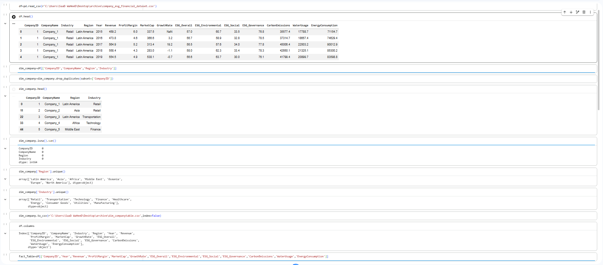
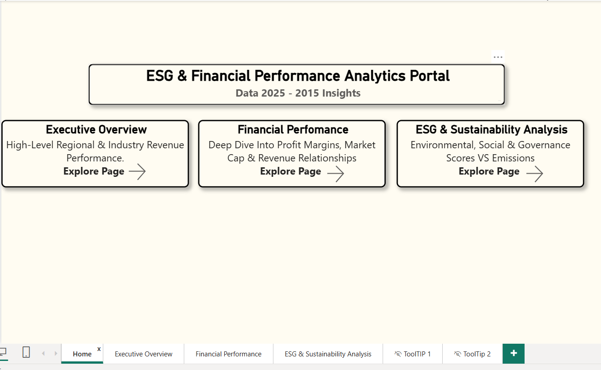
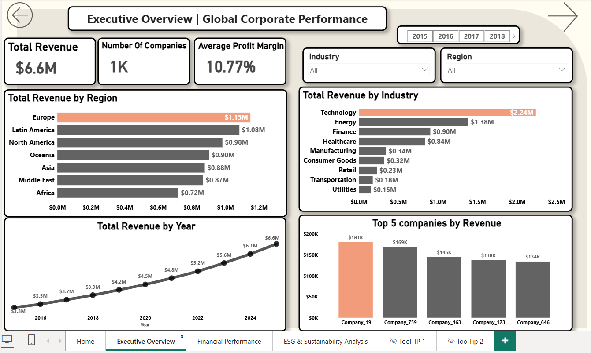
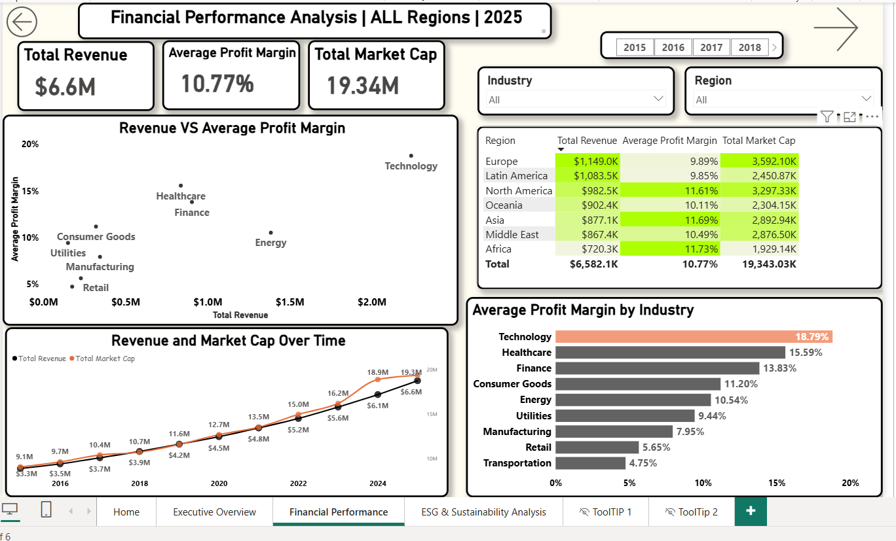
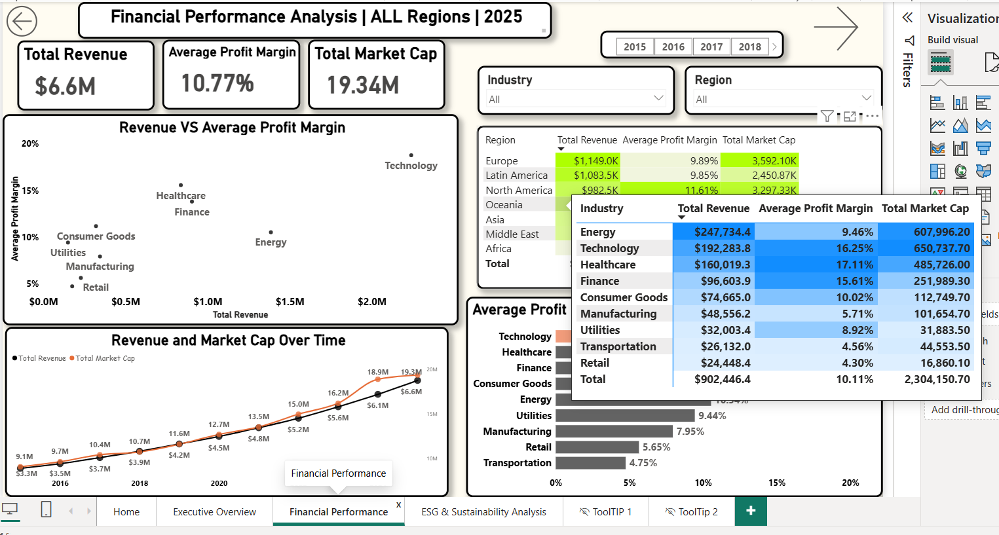
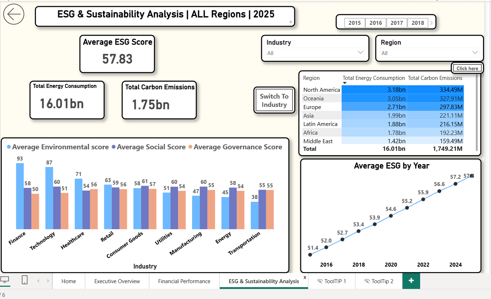
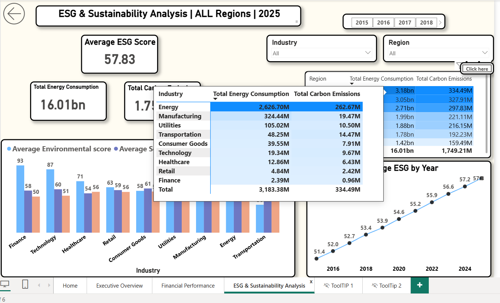

# Global-Company-Financial-Analysis-
End-to-end data analysis project using Python (Pandas) for ETL &amp; Star Schema modeling, and Power BI for interactive dashboarding &amp; DAX financial insights.
# Global Company Financial & Performance Analysis (2015 - 2026)

## Project Overview
Over the past week, I’ve been working on analyzing a comprehensive global dataset covering 1,000 companies to uncover key financial metrics, sector dynamics, and regional performance trends.

---

##  Data Transformation & Cleaning (Python / Pandas)
Before diving into the Power BI dashboard, I spent time preparing and structuring the dataset using **Python (Pandas)**. 

The raw data came in a flat file, so I used Python to clean it up, handle missing values, and split it into a structured **Star Schema** with proper Fact and Dimension tables (`dim_company`, `Fact_Table`). This made the dataset much lighter and ready for seamless modeling and DAX calculations in Power BI.

>  *View the full Jupyter Notebook implementation in [`ESG_Data_Cleaning.ipynb`](ESG_Data_Cleaning.ipynb).*

---

##  Interactive Power BI Dashboard

###  Dynamic DAX Header in Action

---
###  Dashboard Pages (Overview)
Here is a preview of the main report pages included in the analysis:
* 
* 
* 
* 
* .
* 
* ### 🔍 Advanced Features & Data Architecture
* **Custom Tooltips (Interactive Hover Details):**
  * 
  * 
    * **Star Schema Data Modeling:**
  * 
##  Key Insights & Business Findings

### Industry & Sector Trends
* **Technology Leadership:** In 2026, Technology drives the highest revenue across all industries (**$2.24M**), accounting for over one-third of total market activity.
* **Bottom Sectors:** While Technology dominates total sales, **Utilities ($0.15M)** and **Transportation ($0.18M)** sit at the bottom, generating less than 5% of total market revenue combined. Every single year from 2015 to 2026, the Tech sector always led, while Transportation and Utilities were consistently at the bottom.

###  Regional Performance
* **Top Regions:** In 2026, **Europe ($1.15M)** and **Latin America ($1.08M)** are the top-performing regions, combined generating over one-third of total global revenue across the 1,000 companies.
* **Lowest Revenue Region:** **Africa** generates the lowest revenue (**$0.72M**). (This was also the case consistently from 2015 to 2026: Europe and Latin America at the top, Africa at the bottom).
* **Regional Deviations:**
  * **Asia:** The **Finance** sector achieves 2nd place right behind Tech, Transportation improves significantly, and Retail drops to the bottom.
  * **Middle East:** Energy slips slightly while Finance improves and achieves better numbers.

###  Profitability & Valuation
* **Profit Margin Leaders:** Technology leads in profitability with an **18.79%** average profit margin, followed closely by Healthcare (**15.59%**) and Finance (**13.83%**).
* **Operational Efficiency:** Utilities demonstrates solid operational efficiency with a **10.54%** profit margin—nearly double that of Retail (5.65%) and Transportation (4.75%). Yet its low total revenue limits actual financial return.
* **Market Capitalization:** Europe and Latin America hold the largest share of market valuation with **$3.59M** and **$2.45M** in Market Cap respectively (31% of overall valuation), aligning with their high revenue contribution.
* **Valuation Multiple:** Total Market Cap has consistently grown alongside Total Revenue, maintaining a stable **2.9x - 3.0x** valuation multiple from 2015 to 2026.
